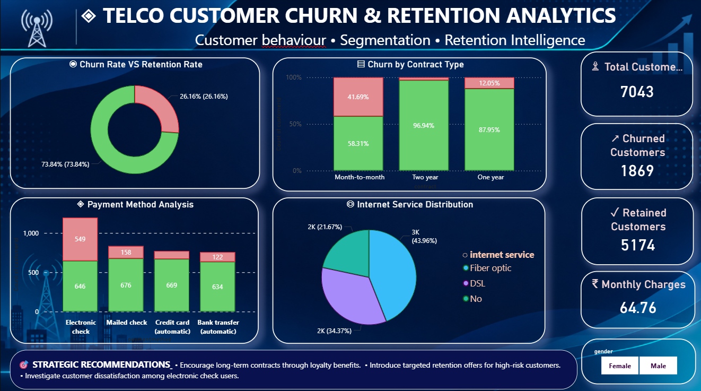

# 📡 Telco Customer Churn Analysis

<div align="center">


<br/>


</div>

---

### 🔍 What's This Project About?

Why do customers leave a telecom service? Which patterns can customer data reveal?

This project explores **Telco Customer Churn** through Python-based data analysis and an interactive Power BI dashboard. From cleaning raw data to uncovering churn-related patterns, the goal is to turn customer information into meaningful business insights.

### 🎯 What I Did

- 🧹 **Data Cleaning:** Inspected, cleaned and prepared the dataset using Pandas.
- 🔎 **Exploratory Analysis:** Explored customer data to understand churn patterns and relationships.
- 📊 **Data Visualization:** Used Matplotlib and Seaborn to create meaningful visualizations.
- 📈 **Dashboard Development:** Built an interactive Power BI dashboard to present analytical insights.

### 🖥️ Dashboard Preview

<div align="center">



*Explore the dashboard for a visual view of customer churn analysis.*

</div>

### 🛠️ Tech Stack

| Technology | How I Used It |
|---|---|
| Python | Data analysis |
| Pandas | Data cleaning and manipulation |
| Matplotlib | Data visualization |
| Seaborn | Exploratory visualizations |
| Power BI | Interactive dashboard |

### 📂 Project Structure

```text
Telco-Customer-Churn-Analysis/
│
├── images/
│   └── dashboard.png
│
├── python/
│   ├── 1.data_understand_cleaning
│   ├── 2. EDA_analysis
│   └── EDA_and_visualizations
│
├── power BI/
│   └── Telco_customer_churn_dashboard
│
└── README.md
```

### 💡 Key Takeaways

Through this project, I gained practical experience in:

- Preparing and transforming datasets using Python.
- Performing exploratory data analysis.
- Identifying and communicating patterns in customer data.
- Building dashboards to make analytical findings easier to understand.

---

<div align="center">

### ✨ From Raw Data to Meaningful Insights

**Thanks for stopping by! If you find this project interesting, feel free to ⭐ the repository.**


</div>
